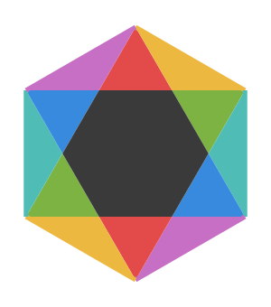

# AI 个性色彩盘 · AI Personality Colour Dial

Assigning and reading a "personality colour" for AI.

---

## 图 1 · 色彩盘 — Figure 1 · The Colour Dial

A hexagonal structure built from three primary colours and the blends between them.

- **Primary colours** map to three personality directions: **Hot** (red), **Temperate** (green) and **Cold** (blue).
- **Blended colours** map to the bias between two neighbouring primaries — for instance, red and green give *hot-leaning-temperate*.
- The same structure doubles as the product's **settings mark** and as a **hexagonal radar mark**.

## 图 3 · 几何银河系 — Figure 3 · The Geometric Galaxy

An eight-arm spiral showing how one and the same set of personality colours shifts in **temperature** across the **sensitive** and the **rational** side.

Two coloured arms face each other at 180°, setting up the contrast between the two sides; the remaining directions are rendered in greyscale to mark the layers running from the inside out.

---

*This page is an overview only. Colour ratios, grading rules and the evaluation flow are internal and are not covered here.*

*中文版见 [README\_zh.md](README_zh.md)。*
